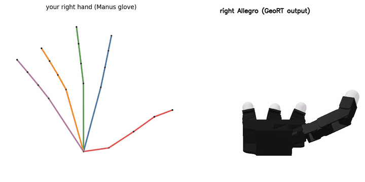
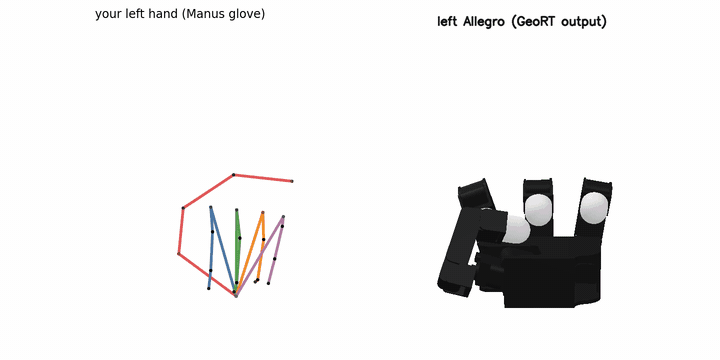
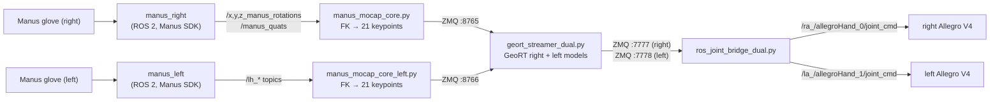
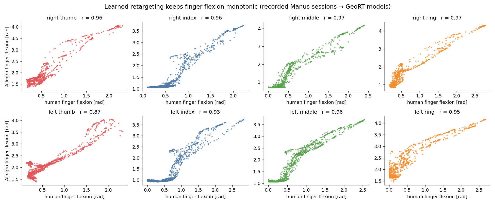

# Allegro Hand Retargeting: Manus Gloves → Two Allegro Hands

[](https://github.com/ismael-esp/allegro-hand-retargeting/actions/workflows/lint.yml)

**Real-time human-to-robot hand retargeting for a bimanual robot.** Two Manus gloves track the operator's
hands, a learned retargeting network ([GeoRT](https://github.com/facebookresearch/GeoRT), Meta / UC Berkeley)
maps each hand's 21 keypoints to the 16 joints of an Allegro Hand V4, and a ROS 2 bridge streams the result to
the left and right Allegro hands of a dual-arm UR3 / UR3e torso. A rule-based baseline
(glove → DexHand gesture model → joint-index map → Allegro) is included for comparison.

<p align="center">
  
  
  <br/><sub>Recorded Manus sessions replayed through the trained models. Left of each clip: your hand's keypoints.
  Right: the Allegro joint angles the model outputs, rendered in SAPIEN.</sub>
</p>

**Project page:** https://ismael-esp.github.io/allegro-hand-retargeting/

This repository is a fork of [facebookresearch/GeoRT](https://github.com/facebookresearch/GeoRT) with its full
history. Everything added for this robot is in a single commit on top, so `git show HEAD --stat` lists exactly what
changed. The original README is kept in [docs/GeoRT_README.md](docs/GeoRT_README.md). GeoRT is licensed
**CC BY-NC 4.0** (non-commercial), and so is this fork.

Related: [dual-arm-allegro-ros2](https://github.com/ismael-esp/dual-arm-allegro-ros2) (the robot drivers these
commands go to) · [dexterous-pick-and-place](https://github.com/ismael-esp/dexterous-pick-and-place) ·
[foundationpose-ros2-tracker](https://github.com/ismael-esp/foundationpose-ros2-tracker).

---

## Contents

- [What was added to GeoRT](#what-was-added-to-geort)
- [Pipeline](#pipeline)
- [Results](#results)
- [Installation](#installation)
- [Usage](#usage): record, train, evaluate, teleoperate
- [Rule-based baseline](#rule-based-baseline)
- [Troubleshooting](#troubleshooting)
- [License and credits](#license-and-credits)

## What was added to GeoRT

| Area | Change |
|---|---|
| **Left hand** | Mirrored Allegro URDF (`assets/allegro_left/`), `geort/config/allegro_left.json` with per-joint `joint_sign` / `joint_offset`, applied in `geort/env/hand.py` before clipping and joint reordering. Left and right are trained as separate models. |
| **Manus gloves, both hands** | ROS 2 C++ clients for the left and right glove (`geort/mocap/manus_client/src/{right_hand_ros,left_hand_ros_v2}.cpp`), and a left-hand keypoint FK node (`manus_mocap_core_left.py`, ZMQ :8766) next to the right one (:8765). |
| **Recording** | `geort/mocap/manus_recorder.py` records a session to `data/<name>.npy` (N × 21 × 3 keypoints in the wrist frame). |
| **Dual-hand runtime** | `geort/mocap/geort_streamer_dual.py` runs both models and publishes `{"hand","qpos"}` on ZMQ :7777 / :7778. `geort/mocap/ros_joint_bridge_dual.py` turns that into `sensor_msgs/JointState` for both Allegro drivers (rate-limited, optional clamping). `scripts/run_dual_teleop.sh` starts the whole chain. |
| **Training** | 400 epochs for the retargeting and FK networks (upstream: 200). |
| **Trained models** | `checkpoint/*/last.pth` + `config.json` for every run (right `right_v1`, left `left_v2` / `left_v3`, plus earlier ones). FK models for both hands. |
| **Evaluation & media** | `scripts/eval_flexion_correlation.py` (per-finger agreement), and `scripts/media/` to render replays like the GIFs above. |
| **Dependencies** | `requirements.txt` pins `sapien==2.2.2` and `numpy<2`. Upstream leaves SAPIEN unpinned, and SAPIEN 3.x breaks `geort/env/hand.py`. |
| **Baseline** | `baseline_rule_based/`: the `dex2all` ROS 2 package, a patch for `dexhand_manus` and the pinned upstream packages. |

## Pipeline



- Keypoints are expressed in a canonical wrist frame: z from the wrist to the middle MCP, and y across the knuckles.
  So the model only sees finger articulation, not where the hand is in space. The arms are driven separately, for
  example by the teleop or policy stack of the robot.
- GeoRT is trained without paired data. It matches fingertip directions and the fingertip point-cloud geometry
  between the human hand and the robot hand (losses: direction, Chamfer, curvature, pinch). Training takes a few
  minutes on a single GPU, and one `model.forward()` takes about 0.7 ms per hand (measured, RTX 5070 Ti).
- The Allegro `joint_cmd` topics are the ones served by the Wonik Allegro driver in
  [dual-arm-allegro-ros2](https://github.com/ismael-esp/dual-arm-allegro-ros2) (`start_robots.launch.py`).

## Results

Per-finger flexion agreement over the recorded sessions (`scripts/eval_flexion_correlation.py`). Human flexion is the
sum of the bend angles along each finger's keypoint chain, and Allegro flexion is the sum of that finger's three
flexion joints.

| Finger | Right hand (`right_v1`, 3,390 frames) | Left hand (`left_v2`, 4,194 frames) |
|---|---|---|
| thumb | **0.96** | 0.87 |
| index | **0.96** | 0.93 |
| middle | **0.97** | 0.96 |
| ring | **0.97** | 0.95 |

<p align="center"></p>

- The mapping is monotonic for every finger, so opening and closing the human hand opens and closes the Allegro.
- **Dead band near full extension:** with the fingers flat (under ~0.5 rad of flexion), the Allegro index, middle
  and ring hold about 1 rad of flexion. The model matches fingertip geometry, not joint angles, and the Allegro's
  longer fingers reach the same fingertip direction with some bend. Above that the response is roughly linear.
- The left thumb is the weakest (r = 0.87). The left hand uses mirrored kinematics with sign/offset corrections,
  and the thumb has the most of them.
- These numbers measure consistency with the operator's hand, not task success. No grasping benchmark was run
  with glove teleoperation.

## Installation

Tested on Ubuntu 22.04, ROS 2 Humble (host), Python 3.11, PyTorch 2.9 + CUDA 12.8, RTX 5070 Ti.

```bash
git clone https://github.com/ismael-esp/allegro-hand-retargeting.git
cd allegro-hand-retargeting

# 1. Python environment for GeoRT (training, streaming)
conda create -n geort python=3.11 -y && conda activate geort
pip install torch --index-url https://download.pytorch.org/whl/cu128      # or the build for your CUDA
pip install -r requirements.txt                                          # sapien==2.2.2, numpy<2, ...
pip install -e .

# 2. Recorded sessions (optional: only needed for evaluation or to retrain on my data)
bash scripts/download_data.sh                                            # → data/manus_*.npy, right_v1.npy

# 3. Manus glove clients (ROS 2 Humble, system Python)
#    Needs MANUS Core running and the gloves paired. The SDK libraries are already in manus_client/lib.
sudo apt install libc-ares2 libprotobuf-dev protobuf-compiler libgrpc++1
cd geort/mocap && source /opt/ros/humble/setup.bash && colcon build && cd -
```

Check it:

```bash
python -c "import geort, numpy as np; m = geort.load_model('right_v1'); print(m.forward(np.zeros((21,3), np.float32)).shape)"
python scripts/eval_flexion_correlation.py        # reproduces the table above (after download_data.sh)
```

## Usage

### 1. Record your hand

```bash
# terminal A: glove client + keypoint FK (right hand → ZMQ :8765)
cd geort/mocap && source install/setup.bash
ros2 run manus_client manus_right & python3 manus_mocap_core.py
# terminal B: record (move every finger through its full range, pinch each finger with the thumb)
python geort/mocap/manus_recorder.py --name my_right --port 8765            # → data/my_right.npy
```

For the left hand, use `manus_left`, `manus_mocap_core_left.py` and port 8766.

### 2. Train

```bash
python geort/trainer.py -hand allegro_right -human_data my_right -ckpt_tag my_right_v1
python geort/trainer.py -hand allegro_left  -human_data my_left  -ckpt_tag my_left_v1
```

On the first run for a hand, the trainer samples the robot's fingertip workspace (cached in `data/allegro_*.npz`) and
trains an FK network (`checkpoint/fk_model_allegro_*.pth`). From a fresh clone, 400 epochs took 280 s on one GPU.
Checkpoints go to `checkpoint/allegro_<side>_<date>_<tag>/`, and `geort.load_model('<tag>')` finds them by substring.

### 3. Evaluate

```bash
python scripts/eval_flexion_correlation.py --right data/my_right.npy:my_right_v1 --left data/my_left.npy:my_left_v1
# replay video (two steps: retarget with SAPIEN 2, render with SAPIEN 3 in a separate env)
python scripts/media/retarget_frames.py --data data/my_right.npy --ckpt my_right_v1 --hand allegro_right \
       --start 0 --n 300 --stride 3 --out /tmp/right.npz
python scripts/media/render_frames.py --npz /tmp/right.npz --out /tmp/frames_right     # needs: pip install sapien==3.0.1
```

### 4. Teleoperate both Allegro hands

Bring up the hands first, with the Wonik driver from
[dual-arm-allegro-ros2](https://github.com/ismael-esp/dual-arm-allegro-ros2). Then:

```bash
GEORT_ENV=geort ROS_DOMAIN_ID=10 bash scripts/run_dual_teleop.sh
```

This opens four terminal tabs: glove clients, keypoint FK, the GeoRT streamer (`--right_ckpt right_v1 --left_ckpt
left_v2` by default) and the ROS 2 bridge at 60 Hz. To drive only one hand, run the streamer with
`--hand_selc_pub right`.

## Rule-based baseline

The earlier pipeline maps glove data through the DexHand gesture model and a fixed joint-index table:

```
Manus glove → manus_ros2 (PoseArray) → dexhand_manus (patched: left + right outputs, la/ra_dex_joint_states)
            → dex2all (DexHand joint i → Allegro joint j, velocity feed-forward, grip effort) → Allegro joint_cmd
```

```bash
# in a ROS 2 Humble workspace <ws>, with REPO=/path/to/allegro-hand-retargeting
cd <ws>
vcs import src < $REPO/baseline_rule_based/baseline.repos
git -C src/dexhand_manus apply $REPO/baseline_rule_based/patches/dexhand_manus.patch
cp -r $REPO/baseline_rule_based/dex2all src/
# put the MANUS Core SDK into src/manus_ros2/ext/ (see its readme), then
colcon build && source install/setup.bash
ros2 launch dexhand_manus simulation.launch.py      # glove → DexHand
ros2 run dex2all ra_dext_to_all                     # DexHand → right Allegro (la_dext_to_all_v2 for the left)
```

Learned vs rule-based: the baseline copies joint angles one-to-one through a fixed index table. By construction it
doesn't account for different finger lengths, the thumb's very different kinematics or the Allegro's joint limits.
GeoRT instead matches fingertip geometry and has an explicit pinch loss. The comparison here is qualitative: both pipelines run on the same robot,
but no side-by-side metric was recorded.

## Troubleshooting

| Symptom | Fix |
|---|---|
| `AttributeError: ... 'PhysxSceneConfig' ... default_dynamic_friction` or `no attribute 'VulkanRenderer'` | SAPIEN 3.x is installed. `pip install sapien==2.2.2 "numpy<2"`. |
| Training segfaults at `0/100000` | NumPy 2.x with SAPIEN 2.2.2. `pip install "numpy<2"`. |
| SAPIEN viewer fails with `ErrorExtensionNotPresent` (e.g. RTX 50-series) | SAPIEN 2's Vulkan renderer doesn't support that GPU/driver. Training and teleop don't need it. For visuals use `scripts/media/render_frames.py` (SAPIEN 3) in a separate env. |
| `manus_client` link errors (`ares_*`, protobuf) | Missing system libraries (see Installation step 3). On Ubuntu 24.04 the bundled gRPC/protobuf versions don't match, so build on 22.04 / Humble. |
| Left hand bends the wrong way | Check `joint_sign` / `joint_offset` in `geort/config/allegro_left.json` and retrain. |
| Bridge runs but the hands don't move | `ROS_DOMAIN_ID` / RMW must match the robot, and the Allegro driver must be the Wonik one (`/ra_/allegroHand_0/joint_cmd`). |

## License and credits

- **GeoRT** © UC Berkeley and Meta Platforms, Inc. and affiliates. CC BY-NC 4.0 ([LICENSE](LICENSE)). Paper:
  *Geometric Retargeting: A Principled, Ultrafast Neural Hand Retargeting Algorithm* (Zhaoheng Yin et al.).
- Additions in this fork © 2026 Ismael Espinoza, released under the same CC BY-NC 4.0 terms.
- MANUS SDK libraries in `geort/mocap/manus_client/lib` are © MANUS (as shipped by upstream GeoRT).
- Baseline dependencies: [iotdesignshop](https://github.com/iotdesignshop) `manus_ros2`, `dexhand_manus`,
  `dexhand_manus_gui`, `dexhand_description` (fetched, not redistributed). The `dexhand_manus` change ships as a patch.

---

The additions in this fork were developed 2025-2026 by Ismael Espinoza Jaramillo (PhD candidate, Kyung Hee University) in the lab's private workspace and published as one commit on top of the GeoRT history in Oct 2026 · [ismael-esp.github.io](https://ismael-esp.github.io) · [github.com/ismael-esp](https://github.com/ismael-esp)
